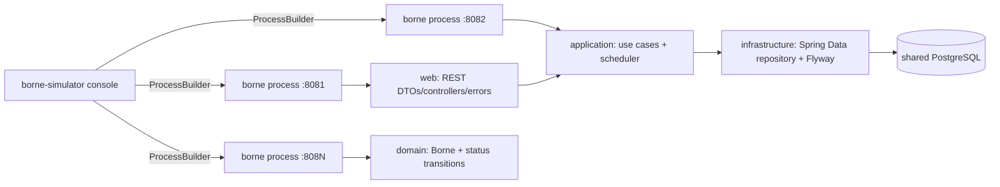

# Borne platform

This project contains two independent Maven applications:

* **borne** is a Spring Boot REST service for one or more charging stations. Each
  process has a configurable `borne.id` and `server.port`, while every process
  shares the same PostgreSQL database.
* **borne-simulator** is a small Java console application. It starts several
  `borne` JAR processes with `ProcessBuilder`, assigns each a different port and
  ID, displays status, and gracefully stops child processes.

## Architecture



The `borne` project follows `domain`, `application`, `infrastructure`, and
`web` packages. Domain methods enforce transitions:

`AVAILABLE -> RESERVED -> CHARGING -> AVAILABLE`.

Any state can be marked `OUT_OF_SERVICE`, and only an out-of-service station
can be reactivated. A scheduled application service updates charging energy
from elapsed time and the configured charging rate; a full battery returns to
`AVAILABLE`.

The controller only translates HTTP requests and responses. It calls
`BorneService`, which applies use-case rules through the `BorneStore` contract.
`JpaBorneStore` is the infrastructure adapter that delegates to Spring Data
JPA, keeping repository details out of the web layer.

## Run

Requirements: JDK 21 and Maven (or the supplied `mvnw` wrapper).

```bash
export JAVA_HOME=/usr/lib/jvm/java-21-openjdk-amd64
export PATH="$JAVA_HOME/bin:$PATH"
docker compose up -d postgres
./mvnw clean package
```

Run one borne:

```bash
java -jar borne/target/borne-0.0.1-SNAPSHOT.jar \
  --borne.id=borne-1 --server.port=8080
curl http://localhost:8080/api/bornes/borne-1
```

The first start creates the configured borne record if it does not already
exist. The same JAR can be started repeatedly with different IDs and ports:

```bash
java -jar borne/target/borne-0.0.1-SNAPSHOT.jar --borne.id=B001 --server.port=8081
java -jar borne/target/borne-0.0.1-SNAPSHOT.jar --borne.id=B002 --server.port=8082
java -jar borne/target/borne-0.0.1-SNAPSHOT.jar --borne.id=B003 --server.port=8083
```

All three commands use the same `DB_URL`, `DB_USERNAME`, and `DB_PASSWORD`.
Their rows are stored together in the `bornes` table.

The database can be changed with `DB_URL`, `DB_USERNAME`, and `DB_PASSWORD`.
Charging behaviour is configurable with `BORNE_CHARGING_RATE_KW` and
`BORNE_CHARGING_UPDATE_MS`.

Run the simulator from the repository root:

```bash
java -jar borne-simulator/target/borne-simulator-0.0.1-SNAPSHOT.jar \
  --count=3 --base-port=8081 \
  --borne-jar=borne/target/borne-0.0.1-SNAPSHOT.jar
```

Choose **1** to launch, **2** to show process status, **3** to stop all, and
**0** to exit. The simulator inherits the database environment variables.

## API

`GET /api/bornes` and `GET /api/bornes/{id}` read state. State-changing
operations are `POST /api/bornes/{id}/reserve`, `/release`,
`/start-charging`, `/stop-charging`, `/out-of-service`, and `/reactivate`.
Additional endpoints are:

| Method | Endpoint | Purpose |
|---|---|---|
| POST | `/api/bornes` | Register a borne |
| PUT | `/api/bornes/{id}/status` | Apply a supported status transition |
| GET | `/api/bornes/{id}/status` | Read the current status |
| GET | `/api/bornes/{id}/consumption` | Read energy and configured power |

Example:

```bash
curl -X POST http://localhost:8081/api/bornes \
  -H 'Content-Type: application/json' \
  -d '{"id":"B001","batteryCapacityKwh":50,"powerKw":7.2}'
curl -X POST http://localhost:8081/api/bornes/B001/reserve
curl -X POST http://localhost:8081/api/bornes/B001/start-charging
curl http://localhost:8081/api/bornes/B001/consumption
```

Invalid transitions return HTTP 409, missing bornes return 404, and errors use
a stable JSON DTO.

Flyway migration `V1__create_bornes.sql` creates the `bornes` table with the
identifier, status, energy, power, timestamps, and optimistic-lock version.
Tests use an isolated H2 database; production uses PostgreSQL.

## Testing

Run all tests from the root:

```bash
JAVA_HOME=/usr/lib/jvm/java-21-openjdk-amd64 \
PATH="$JAVA_HOME/bin:$PATH" \
./mvnw test
```

The suite covers domain transitions and charging, application services,
repository persistence, REST responses and errors, and simulator
configuration/process command construction. A live PostgreSQL demonstration
can query `SELECT id, status, energy_kwh FROM bornes` after launching B001,
B002, and B003 against the shared database.

## Limitations and future improvements

The simulator uses local Java processes and assumes the Borne JAR and database
are available. It reports process liveness, not full HTTP readiness. Future
work could add readiness probes, reservation and consumption history,
authentication, or MQTT integration if required by the wider project.
